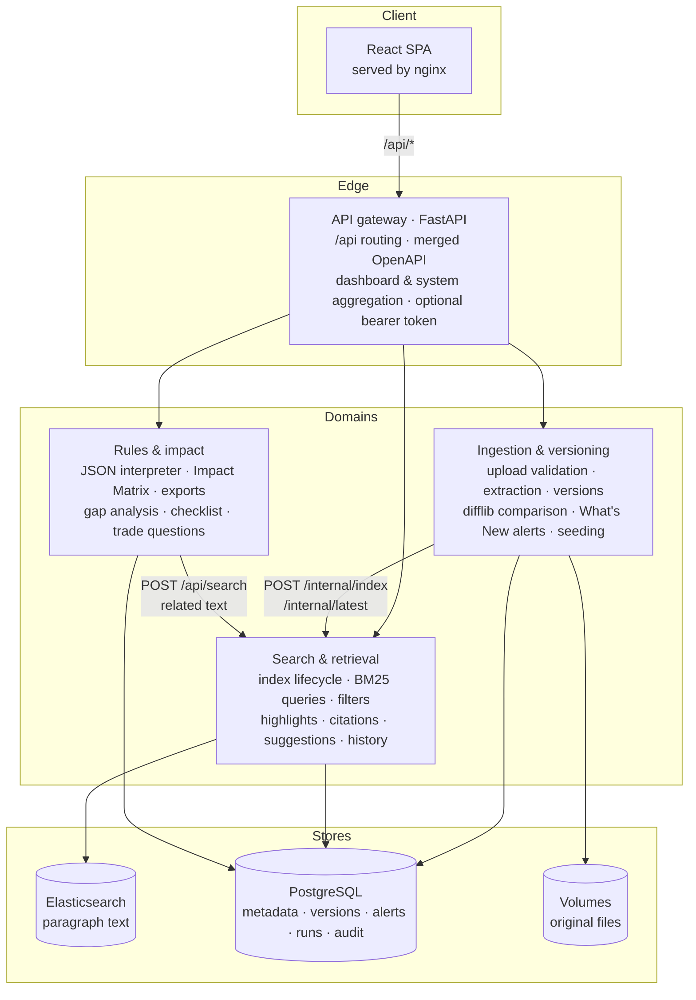
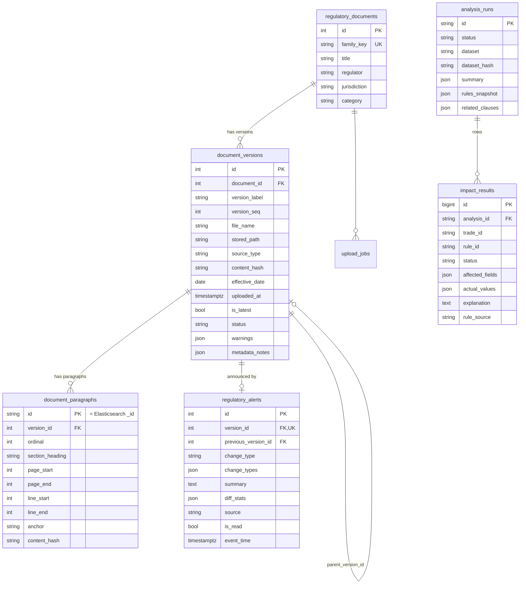
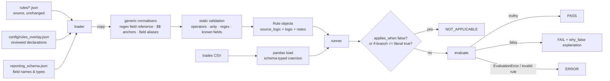

# Reg IRIS — Architecture

## 1. Services and responsibilities



| Service | Port | Owns | Key modules |
| --- | --- | --- | --- |
| `gateway` | 8000 (published) | nothing persistent | `routing.py` (prefix → service, token rules), `openapi_merge.py`, `main.py` (streaming proxy, `/api/dashboard/stats`, `/api/system/status`, Swagger with vendored assets) |
| `ingestion` | 8001 | `regulatory_documents`, `document_versions`, `document_paragraphs`, `upload_jobs`, `regulatory_alerts`, `import_runs` | `parsers/` (PDF, HTML, TXT, shared clause segmenter), `services/metadata.py`, `pipeline.py`, `diffing.py`, `seeding.py`, `uploads.py`, `storage.py` |
| `search` | 8002 | Elasticsearch index, `search_history` | `indexing/mapping.py`, `indexing/indexer.py`, `search/query_builder.py`, `search/highlight.py`, `search/service.py`, `history.py` |
| `rules` | 8003 | `rule_set_loads`, `analysis_runs`, `impact_results` | `engine/` (expressions, normalisation, loader, runner, explain, render, dataset), `analysis/` (core, runs, export, related, trade_query) |
| `frontend` | 3000 (published) | — | nginx serves the SPA and proxies `/api` to the gateway |

The output/alert domain (What's New, alerts, exports, summaries, audit) is implemented as clearly separated modules: alerts in the ingestion service (they are produced by ingestion events), exports and summaries in the rules service (they are views of analysis runs). `audit_events` is an append-only table every service writes to.

**Contracts.** Public endpoints live under `/api/*` and are the only ones the gateway routes. Service-to-service endpoints live under `/internal/*`, require the `X-Internal-Token` shared secret and are never reachable through the gateway. Every error uses the envelope `{"error": {code, message, details, request_id}}`; a request id is propagated from the gateway.

**Shared package.** `shared/iris_shared` holds only what is genuinely common: settings, SQLAlchemy models and sessions, the Alembic migration, structured logging, the error envelope / internal-auth helpers, audit helper and text normalisation.

## 2. Data model



Other tables: `upload_jobs`, `import_runs`, `search_history`, `rule_set_loads`, `audit_events`.

Constraints worth noting: `(document_id, version_label)`, `(document_id, content_hash)` and `(document_id, version_seq)` are unique, so the same file cannot become two versions and labels cannot collide; one alert per version (`uq_alert_version`) makes alert creation idempotent.

**Where text lives.** Full paragraph text is stored only in Elasticsearch. PostgreSQL keeps location metadata (page, heading, anchor, hash) so the chain *document → version → paragraph → Elasticsearch document* is navigable from either side. The original files are kept untouched (the dataset is mounted read-only; uploads go to a volume) and are re-parsed on demand for previews and comparisons.

**Migrations.** One Alembic revision (`shared/iris_shared/migrations/versions/0001_initial.py`) is applied by the one-shot `migrate` container before any service starts. CI compares the migrated PostgreSQL schema with the models (`shared/tests/test_migrations.py`).

## 3. Document ingestion pipeline

```mermaid
sequenceDiagram
  autonumber
  participant U as UI / seed
  participant I as Ingestion
  participant P as PostgreSQL
  participant S as Search
  participant E as Elasticsearch
  U->>I: POST /api/documents/upload (multipart)
  I->>I: validate extension, size, magic bytes, encoding; safe file name
  I->>P: duplicate / label checks, upload_jobs (queued)
  I-->>U: 202 {job_id}
  Note over I: background task
  I->>I: parse → clauses (page / anchor / lines)
  I->>P: document_versions + document_paragraphs (processing)
  I->>S: POST /internal/index (paragraph docs)
  S->>E: delete_by_query(version) + bulk index (stable _id)
  I->>S: POST /internal/latest
  S->>E: update_by_query is_latest
  I->>I: re-parse previous version, difflib comparison
  I->>P: regulatory_alerts (unread), job → indexed, audit
  U->>I: GET /api/documents/uploads/{job_id} (polling)
```

**Extraction.**

- *PDF* — PyMuPDF `get_text("blocks")` page by page, so every line carries its real page number. Empty pages produce a warning (no OCR). Encrypted or corrupt files fail the job with the reason.
- *HTML* — BeautifulSoup; `script`, `style`, `iframe`, `svg` etc. are removed; each `h1–h6` starts a section; list items become bullet lines; the first `id` in a section is kept as the citation anchor. No page numbers are produced.
- *TXT* — blank lines separate paragraphs; every clause keeps its source line range.

**Clause segmentation** (`parsers/segmenter.py`, shared by PDF and TXT): a heading line (`Paragraph 3. …`, `Article 25`, `Q4: …`, `2. Mandatory Reporting Fields`) starts a clause; a short standalone title line between sentences (such as the Dodd-Frank title embedded in EMIR v2) becomes its own clause instead of being glued to the previous one; body blocks merge into the current clause across page breaks (`page_start`/`page_end`); clauses over 2,400 characters split at block boundaries into numbered parts; page furniture is dropped. Whitespace and Unicode presentation characters (non-breaking spaces and hyphens) are normalised; meaning-bearing punctuation such as en dashes is kept.

**Identifiers.** Paragraph id = `v{version_id}-p{ordinal:04d}`, used as both the PostgreSQL key and the Elasticsearch `_id`, so re-indexing overwrites instead of duplicating.

**Seeding.** `services/seeding.py` runs once in a background thread at start-up (and on `POST /api/imports/run`), guarded by a lock. It is idempotent: an existing version with the same family and file hash is skipped when its paragraph count matches the index, re-indexed when the index lost it, and retried if an earlier attempt failed. A fresh database resets the index; a final reconciliation deletes index entries whose version no longer exists. Alerts created by the seed use the metadata's historical `upload_timestamp` and are marked read.

## 4. Elasticsearch indexing and search

**Index.** `reg-iris-paragraphs-v1` behind the alias `reg-iris-paragraphs`; one shard, no replicas (single-node laptop setup); strict mapping.

| Analyzer | Chain | Used for |
| --- | --- | --- |
| `reg_text` | `_`→space char filter, standard tokenizer, lowercase, ASCII folding, possessive, light English (KStem) | `content`, `section_heading`, `document_title`, `regulator.text` |
| `reg_exact` | same, no stemming | `*.exact` subfields: quoted phrases and phrase boosts |
| `reg_text_syn` | `reg_text` + synonym graph (`config/synonyms.txt`) | search-time only, `*.syn` subfields |

The underscore char filter means `Counterparty_LEI` in the regulations is found by *counterparty lei* and by the phrase `"Counterparty LEI"`.

**Query construction** (`search/query_builder.py`, pure and unit-tested):

```text
bool
  must
    bool.should (min 1)                                      ← recall
      multi_match cross_fields  content, section_heading^3, document_title^1.5, regulator.text^2
                                minimum_should_match "3<75%"  (all terms up to three, then 75 %)
      match content.syn (synonym-expanded, AND)
    multi_match phrase on content.exact, section_heading.exact^2   ← one per "quoted phrase"
  must_not  multi_match on -excluded words
  should                                                     ← ranking
    phrase of the free text (slop 0) on content.exact^2, section_heading.exact^4
    phrase (slop 3) on content.exact
    match section_heading.syn
post_filter  terms / ranges / scope (is_latest | document_version_id)
aggs         facet counts within the scope (ignoring the other filters)
highlight    unified, encoder=html, whole paragraph
```

Ranking is BM25. Free-text questions are trimmed of documented noise words (`config/query_noise_words.txt`); quoted phrases are never altered or synonym-expanded. If a multi-term query finds nothing, the service retries once with `minimum_should_match: 1` and marks the response `relaxed` with a visible notice. With zero results the response carries a term-suggester "did you mean" and hints about filters and version scope — never invented results.

**Highlight safety.** Elasticsearch escapes the text (`encoder: html`) and inserts `<mark>`; the service splits on those tags, unescapes each piece and returns `[{text, highlight}]` segments. The UI renders segments as text nodes, so document content can never inject HTML.

**Citations.** Built from indexed metadata: PDF → `Page N` and `…/source?version_id=…#page=N`; HTML → `Section #anchor`, no page; TXT → `Lines a–b`. The viewer route `/viewer/{version}?paragraph=…` shows the original file next to the extracted clause.

**Identical text.** For the hits on a page, a terms aggregation over `content_hash` lists other documents/versions containing exactly the same paragraph (this is how the duplicated Dodd-Frank text in EMIR v2 becomes visible).

## 5. Version comparison

`services/diffing.py`:

1. Clauses are reduced to normalised full text (heading + body).
2. `difflib.SequenceMatcher` aligns the two clause lists into equal / insert / delete / replace blocks.
3. Inside a replace block, old and new clauses are paired in order when their headings match (ignoring a trailing `(vX.Y)` tag) or their similarity is ≥ 0.55; paired clauses are *modified*, the rest *removed* or *added*.
4. Modified clauses get a word-level inline diff.
5. The summary lists counts and the first headings of each change type with their pages — it is built only from these measurements.

Change types on an alert are `New Document` or `New Version`, plus `Added / Removed / Modified Clause` only when the diff found them. On the supplied data: MiFID II v1 → v2 adds Paragraph 7 (p. 2); SEC v1 → v2 adds Paragraph 8 (p. 2); EMIR v1.0 → v1.1 adds ten clauses: Paragraph 7, plus the title line, file-name line and seven paragraphs of the embedded Dodd-Frank copy.

## 6. JSON rule evaluation



- The interpreter (`engine/expressions.py`) walks plain JSON with a fixed operator registry — no `eval`, no attribute access, depth-limited, regex length-limited.
- Missing values (absent, empty string, null) are `None`. Ordering comparisons with a missing operand are false (unlike JavaScript's `null >= 0`). Comparing a number with a non-numeric string is an `ERROR`, never a pass.
- **Applicability.** A rule is NOT_APPLICABLE when its `applies_when` expression (in the rule file, or declared in the overlay) is false, or when its top-level `if` selects a branch that is the literal `true` — the conditional requirement is not triggered (MIFID-3 for non-derivatives) or explicitly waived (FCA-2 for FX).
- **Explanations** (`engine/explain.py`) follow the evaluator's own semantics (short-circuit `and`, selected `if` branch) to name the failing sub-condition with the actual values, e.g. *"Because Asset_Class == "Derivative" holds (Asset_Class = 'Derivative'): Maturity_Date is missing. Rule impact: Derivatives need a Maturity_Date."* Each failure is categorised (missing value, invalid format, value not allowed, negative value, numeric bound, date constraint …) for gap analysis.
- Zero-code updates: add a JSON file to `data/rules/`, `POST /api/rules/reload`. `POST /api/rules/validate` checks a document without saving it.

Full rule reference: [docs/RULES.md](docs/RULES.md).

## 7. Impact Matrix generation

`POST /api/impact-matrix` selects rules (by regulator / id), loads the dataset, evaluates every trade × rule, summarises (status counts, unique impacted trades, by regulator / rule / asset class / failure category, top impacted trades), looks up related regulatory text per rule through the search service (labelled informational), and persists the run plus one row per evaluation in a single bulk insert. The request returns the run (201) or, with `run_async: true`, a job id (202) to poll. Reads are server-side filtered, sorted and paginated; exports stream CSV from the stored rows with formula-injection protection (cells starting with `= + - @` are prefixed with `'` unless they are plain numbers such as `-99.9`). Output is deterministic for the same files: trades in file order, rules in file order, and the dataset hash is stored on each run.

## 8. Frontend

React SPA with React Router and TanStack Query; every screen reads live API data (no static fixtures). Pages: Dashboard, Regulatory search, Documents (upload drawer, version history), What's new (timeline), Version comparison, Source viewer, Impact analysis, Compliance checklist / gap analysis, Rules, Alerts, System health. Unread alerts are polled every 5 s; a new alert id triggers a toast. Design tokens are CSS variables with light and dark themes; charts read the resolved token colours.

## 9. Security notes

Upload validation (extension allow-list, size, PDF magic bytes, binary detection), safe file names and storage paths confined to the upload root; source files served with `nosniff`, HTML served with a `sandbox` CSP and shown in a sandboxed iframe; highlights rendered as text; parameterised SQL through SQLAlchemy; CSV formula-injection guard; internal endpoints behind a shared secret and not routed by the gateway; optional bearer token for mutating operations; CORS restricted to configured origins; secrets only from environment variables; logs are JSON without secret values.
