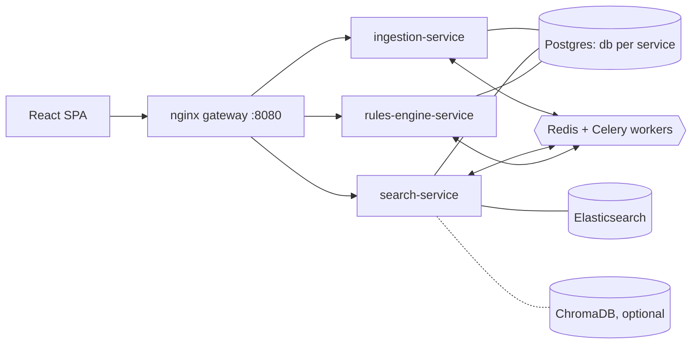

# Reg IRIS — Intelligent Regulatory Repository & Impact Scanner

A microservices platform that turns unstructured regulatory text into a **versioned, searchable clause repository**
and checks **trade data against machine-readable JSON rules**, producing an explained, traceable **Impact Matrix**.

| Module | Service | What it does |
|---|---|---|
| 1. Ingestion & Versioning | `services/ingestion-service` (:8001) | Upload PDF/HTML/TXT, exact-duplicate + similar-document detection, match suggestions, clause parsing, ACTIVE/INACTIVE version history, version diff, What's New cards, alerts |
| 2. Search & Comparison | `services/search-service` (:8002) | Elasticsearch clause search with filters and clickable citations (document + page), optional semantic search (ChromaDB), clause-level comparison of any two versions/regulations |
| 3. Rules & Impact Analysis | `services/rules-engine-service` (:8003) | JSON rule sets (JSONLogic), CSV validation, batch evaluation, PASS/FAIL with explanations, Impact Matrix, statistics, filters, pagination, CSV export, rule → clause traceability |
| UI | `frontend` (via gateway :8080) | React + TypeScript + Tailwind dashboard |



## Quick start

Prerequisites: Docker 24+ with Compose v2 (≈4 GB RAM free for Elasticsearch). Python 3.12 and Node 20 only for local development.

```bash
cp .env.example .env
docker compose up --build -d          # first build takes a few minutes; restarts target < 1 minute
python3 scripts/seed_sample_data.py   # loads data/sample_input and runs an impact analysis (or: make seed)
```

| URL | |
|---|---|
| http://localhost:8080 | UI (and the API gateway: `/api/v1/...`) |
| http://localhost:8001/docs | Swagger — ingestion |
| http://localhost:8002/docs | Swagger — search |
| http://localhost:8003/docs | Swagger — rules & impact |
| http://localhost:9200 | Elasticsearch (local only) |

Semantic search: `make up-semantic` (adds ChromaDB, builds the search image with sentence-transformers, `ENABLE_SEMANTIC=true`).

## Repository layout

```
reg-iris/
├── README.md                     ← you are here
├── docker-compose.yml            ← whole stack, one command
├── .env.example                  ← every setting, no secrets
├── Makefile                      ← up / down / seed / test / lint / migrations
├── pyproject.toml                ← ruff config (repo-wide)
├── .github/
│   ├── workflows/ci.yml          ← lint · tests per service · migrations on Postgres · frontend · images · compose smoke
│   ├── CODEOWNERS                ← team ownership
│   └── pull_request_template.md
├── docs/
│   ├── ARCHITECTURE.md           ← microservices architecture, principles, scaling, security
│   ├── DATABASE.md               ← schemas, ER diagrams, ES mapping, constraints
│   ├── API.md                    ← REST API specification
│   ├── SERVICE_COMMUNICATION.md  ← REST + Celery contracts, sequence diagrams
│   ├── FRONTEND.md               ← component structure & conventions
│   ├── TEAM_PLAN.md              ← 4 teams / 8 devs implementation plan
│   ├── DATASET_NOTES.md          ← issues found in the sample data and how they're handled
│   └── adr/                      ← architecture decision records
├── libs/
│   └── iris-common/              ← shared platform lib: config, JSON logging, errors, pagination,
│                                   health, app factory, HTTP client, clause diff, event contracts
├── services/
│   ├── ingestion-service/        ← Module 1 (Team 1)
│   │   ├── app/{models,schemas,parsers,services,api/v1}/, tasks.py, storage.py
│   │   ├── migrations/  tests/  Dockerfile  requirements*.txt
│   ├── search-service/           ← Module 2 (Team 2)
│   │   ├── app/{backends,services,api/v1}/, tasks.py
│   │   ├── migrations/  tests/  Dockerfile  requirements*.txt
│   └── rules-engine-service/     ← Module 3 (Team 3)
│       ├── app/{engine,trades,services,api/v1}/, tasks.py
│       ├── migrations/  tests/  Dockerfile  requirements*.txt
├── frontend/                     ← React + TS + Tailwind (Team 4)
│   └── src/{api,components,features/{dashboard,documents,search,compare,impact},lib}
├── gateway/nginx.conf            ← API gateway routing
├── infra/postgres/init/          ← creates one database per service
├── scripts/seed_sample_data.py   ← demo loader (stdlib only)
└── data/sample_input/            ← hackathon dataset (regulations, rules, trades, schema, metadata, queries)
```

## Development

```bash
make venv            # .venv with iris-common + every service's dev requirements
make test            # all Python suites (SQLite + fakes — no Docker needed)
make lint            # ruff + eslint + tsc
make frontend-dev    # Vite on :5173, proxying /api to the compose gateway
make migration-rules-engine-service m="add severity weight"   # new Alembic revision
```

Each service runs standalone (see its README): `uvicorn app.main:app --port 800X` with `DATABASE_URL=sqlite:///…`;
search-service also works without Elasticsearch (`SEARCH_BACKEND=memory`).

Test suites: `libs/iris-common` (4), ingestion (14), search (8), rules (26), frontend (5) — covering parsing, dedupe,
versioning/rollback, match suggestions, search filters & citations, comparison, JSONLogic operators, explanations,
NOT_APPLICABLE scoping, linting, CSV validation, end-to-end impact runs, pagination and CSV export.

## Configuration
All settings are environment variables (see `.env.example` and each service's `app/config.py`). Notable:
`API_TOKEN` (enables bearer auth), `MAX_UPLOAD_MB`, `ENABLE_SEMANTIC`, `RULES_CHUNK_SIZE`,
`RULES_WORKER_CONCURRENCY`, `FANOUT_THRESHOLD_ROWS`, `SEARCH_BACKEND`.

## Assumptions
* Regulations are provided locally (no web scraping); only synthetic trade data is used; the system detects gaps and
  never files reports.
* A *document* is a logical regulation; each upload is an immutable *version*; the *clause* (paragraph/article/section/
  Q&A) is the unit of search, diff and citation.
* Rules are evaluated against the trade reporting schema in `rules-engine-service/app/trades/reporting_schema.json`
  (normalised copy of `data/sample_input/schema/reporting_schema.json`).
* Sample data has known defects (e.g. `EMIR_2021_v2.pdf` contains the Dodd-Frank text; `EMIR-1` fails all
  non-derivatives) — see [`docs/DATASET_NOTES.md`](docs/DATASET_NOTES.md). Inputs are kept as provided.

## Status
Initial scaffold: every module works end to end — verified locally on PostgreSQL 16 + Redis with real Celery workers
(including the parallel chord path) and the in-memory search backend; the Docker Compose + Elasticsearch path is
exercised by the `compose-smoke` CI job. What each team builds next is in [`docs/TEAM_PLAN.md`](docs/TEAM_PLAN.md) and each
service's README backlog.
