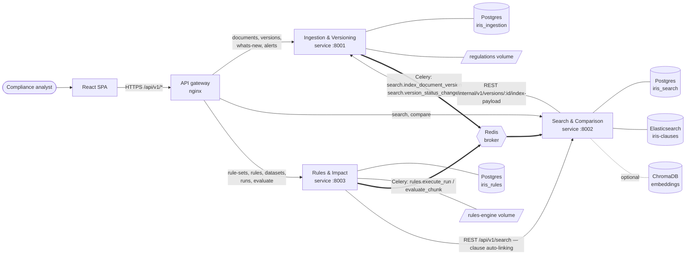

# Reg IRIS — Architecture

Reg IRIS turns unstructured regulatory text (PDF / HTML / TXT) into a searchable, versioned repository and checks
trade data against machine-readable JSON rules, producing an explained, traceable **Impact Matrix**.

## 1. System context



| Container | Image | Purpose |
|---|---|---|
| `gateway` | nginx 1.27 | Single origin for UI + all APIs; routes by resource prefix; hides `/internal/*` |
| `frontend` | nginx serving Vite build | React + TypeScript + Tailwind SPA |
| `ingestion-api` / `ingestion-worker` | `reg-iris/ingestion-service` | Module 1 — upload, dedupe, match suggestions, parsing, versions, diffs, What's New, alerts |
| `search-api` / `search-worker` | `reg-iris/search-service` | Module 2 — indexing, keyword + semantic search, citations, comparison |
| `rules-api` / `rules-worker` | `reg-iris/rules-engine-service` | Module 3 — rule sets, CSV validation, batch evaluation, Impact Matrix, stats, export |
| `postgres` | postgres 16 | One **database per service** (`iris_ingestion`, `iris_search`, `iris_rules`) |
| `redis` | redis 7.4 | Celery broker + result backend |
| `elasticsearch` | 8.15 single node | Clause full-text index |
| `chromadb` (profile `semantic`) | chroma 0.5 | Optional vector store |

## 2. Design principles

1. **Each module is an independently deployable FastAPI service** with its own database, migrations, Docker image,
   test suite, README and CODEOWNERS entry. Teams can ship without coordinating releases.
2. **No shared database, no shared ORM models.** Services exchange data only through REST contracts and event
   payloads defined in `libs/iris-common/src/iris_common/events.py`.
3. **Platform code is shared, business code is not.** `libs/iris-common` holds config, logging, error envelope,
   pagination, health, HTTP client, diff algorithm and text utilities — nothing team-specific.
4. **Async by default for heavy work.** Uploads return `202 Accepted`; parsing, indexing and rule evaluation run in
   Celery workers that scale horizontally.
5. **Rules are data.** The engine contains no regulation-specific `if/else`; every rule is JSONLogic. New
   *primitives* (e.g. `isValidLEI`) are reviewed code, new *rules* are JSON uploads (zero-code rule updates).
6. **Every answer is grounded.** Search hits carry a citation (file, version, clause, page/anchor, clickable URL);
   every FAIL carries an explanation and the clause/version it traces to.
7. **Same layout in every service** (below), so any developer can work in any service.

```
services/<name>/
  app/
    main.py            # create_app(...) from iris_common — middleware, errors, health, Swagger
    config.py          # pydantic-settings, env-driven
    db.py              # engine/session
    celery_app.py      # queue routing from iris_common.events.TASK_ROUTES
    models…            # SQLAlchemy 2.0 models (this service's DB only)
    schemas…           # Pydantic API contracts
    api/v1/…           # thin routers
    services/…         # business logic (pure, testable)
    tasks.py           # Celery tasks owned by this service
  migrations/          # Alembic (one history per service)
  tests/               # pytest; SQLite + fakes, no infra needed
  Dockerfile           # build context = repo root (to include libs/iris-common)
  scripts/entrypoint.sh  # api | worker | migrate
```

## 3. Module responsibilities

### Module 1 — Ingestion & Versioning (`ingestion-service`)
* **Upload** new documents (`POST /documents`) and new versions (`POST /documents/{id}/versions`); validates extension
  **and** content signature (PDF magic bytes, HTML markup, UTF-8 text) and size.
* **Exact duplicates**: SHA-256 with a unique constraint → `409 DUPLICATE_DOCUMENT` with a pointer to the existing version.
* **Similar documents / match suggestions** before upload (`POST /documents/match-suggestions`): MinHash content
  similarity + filename tokens (version tokens stripped) + regulator + title → `DUPLICATE | NEW_VERSION | NEW_DOCUMENT`.
* **Parsing** (worker): PyMuPDF (PDF), BeautifulSoup/lxml (HTML), TXT → pages + **clauses** (citable units:
  "Paragraph N", "Article N", "Section N", "Q5", HTML `<h2>` sections with anchors). Quality warnings (e.g. a file that
  contains two documents) are stored on the version.
* **Versioning**: `ACTIVE`/`INACTIVE`; exactly one ACTIVE per document, enforced by a partial unique index and a row
  lock during activation. Re-activating an old version = rollback.
* **Comparison** of versions of the same document (`GET /versions/{id}/diff`) and **What's New** cards + **alerts**
  generated automatically after each processed upload.
* **Audit log** of every upload/activation/processing event.

### Module 2 — Search & Comparison (`search-service`)
* **Indexer** worker consumes `search.index_document_version`, pulls the clause payload from ingestion's internal API and
  bulk-indexes one ES document per clause (idempotent; id = clause id). `search.version_status_changed` flips
  ACTIVE/INACTIVE in the index so the default search only returns current law.
* **Keyword search** (`GET /search`): `multi_match` over text/title/clause ref + phrase boost, filters (regulator,
  jurisdiction, category, status, effective-date range, document), HTML-escaped `<mark>` highlights, pagination,
  **citation** with `file_url` (`#page=N` for PDF, `#anchor` for HTML).
* **Facets** for filter panels; **query log** for analytics.
* **Semantic search** (optional, `mode=semantic`): sentence-transformers `all-MiniLM-L6-v2` + ChromaDB, same filters
  and response shape; disabled → `501 SEMANTIC_DISABLED`.
* **Compare** any two versions — including different regulations (`POST /compare`) — clause-level ADDED / REMOVED /
  MODIFIED with word-level inline diff; comparisons are saved.

### Module 3 — Rules & Impact Analysis (`rules-engine-service`)
* **Rule sets**: upload JSON (validated against `rule_file.schema.json`, every operator compiled, fields checked against
  the reporting schema, **linter** for logic smells). New upload per regulator = new ACTIVE version; identical upload
  is idempotent. Dry-run validation endpoint.
* **Trade datasets**: CSV validated (UTF-8, required columns, types, enums, patterns, ranges, duplicate IDs) with a
  report; INVALID datasets cannot be run.
* **Engine**: dependency-free JSONLogic evaluator + custom operators (`regex`, `toNumber`, `isDate`, `isValidLEI`,
  `isValidISIN`, …), **strict-null** comparisons, results `PASS | FAIL | NOT_APPLICABLE | ERROR`, human-readable
  **explanations** ("Price (-99.9) must be ≥ 0 — required by MiFID II rule MIFID-2 (…, Paragraph 5, p.1)").
* **Runs**: async; chunked (`CHUNK_SIZE`) streaming read + bulk insert; above `FANOUT_THRESHOLD_ROWS` a Celery
  **chord** evaluates chunks in parallel across workers. The run snapshots its rules for reproducibility.
* **Impact Matrix**: flat (trade × rule) with filtering/sorting/pagination, pivot (trades × rules grid), statistics
  (by rule / regulator / asset class), streaming **CSV export**, single-trade `POST /evaluate` for pipelines.
* **Traceability**: rules link to clauses — declared in JSON (`source.clause_ref`, confirmed) or auto-suggested via
  search-service (flagged *unconfirmed* until a reviewer confirms with `PUT /rules/{id}/clause-link`).

## 4. Cross-cutting concerns

| Concern | Implementation |
|---|---|
| Configuration | `pydantic-settings`; everything from env vars (`.env.example`); no secrets in code |
| Logging | JSON lines to stdout (`iris_common.logging`), one access line per request, `request_id` on every line; gateway logs JSON too. Ship with any collector (Loki/Fluent Bit/ELK). |
| Correlation | `X-Request-ID` generated at the gateway, propagated by `ServiceClient` to downstream calls and echoed in error bodies |
| Errors | One envelope everywhere: `{"error": {code, message, details, request_id}}`; business code raises `IrisError` subclasses |
| API docs | FastAPI OpenAPI per service: `:8001/docs`, `:8002/docs`, `:8003/docs`; raw specs via gateway `/openapi/{ingestion,search,rules}.json` |
| Health | `/health/live` (process) and `/health/ready` (DB / ES checks) on each service; Docker healthchecks gate startup order |
| Auth | Optional static bearer token (`API_TOKEN`) on all non-health routes; replace with OIDC at the gateway in production |
| Migrations | Alembic per service; `api` container runs `alembic upgrade head` before serving; CI verifies upgrade/check/downgrade on real Postgres |
| Testing | pytest per service with SQLite + in-memory fakes (no infra needed); CI also runs migrations on Postgres and a compose smoke test on `main` |

## 5. Scaling & resilience

* **Stateless APIs** — scale with `docker compose up --scale rules-api=3` or replicas in Kubernetes.
* **Workers** — `rules-worker` scales evaluation linearly (chord fan-out); `ingestion-worker` parallelises parsing;
  `task_acks_late` + `prefetch=1` so a crashed worker's task is redelivered.
* **Idempotency** — content-addressed storage, SHA-256 uniqueness, ES documents keyed by clause id, chunk results
  deleted-then-inserted, `process_version` no-ops on READY versions.
* **Large CSVs** — streamed with pandas `chunksize`; results inserted in batches; `validation_results` is indexed by
  `(run_id, status|trade_id|rule_code)`. Next step for 10M+ rows: partition `validation_results` by `run_id` and
  pre-split uploads into chunk files.
* **Match suggestions** compare against all documents in Python (fine to a few thousand). Next step: candidate
  generation with ES `more_like_this` or Chroma, then MinHash re-ranking.
* **Elasticsearch** index lives behind an alias (`iris-clauses` → `iris-clauses-v1`) for zero-downtime re-indexing.
* **Failure isolation** — semantic indexing failures never block keyword indexing; auto-linking failures never block
  rule upload; search being down never blocks a run.

## 6. Security notes (prototype → production)

* Synthetic data only (guardrail). No outbound internet at runtime; models and documents are local.
* Uploads: extension + magic-byte checks, size limit, content-addressed names (no user-controlled paths).
* Search highlights are HTML-escaped by the backend before the UI renders `<mark>`.
* Internal routes are not routed by the gateway; in production put services on a private network and add mTLS or
  service tokens.
* Elasticsearch security is disabled for local compose only.

## 7. Architecture decisions
See [`docs/adr/`](adr/) — microservices + DB-per-service, Celery-by-name messaging, in-house JSONLogic evaluator,
clause as the unit of indexing and citation.
