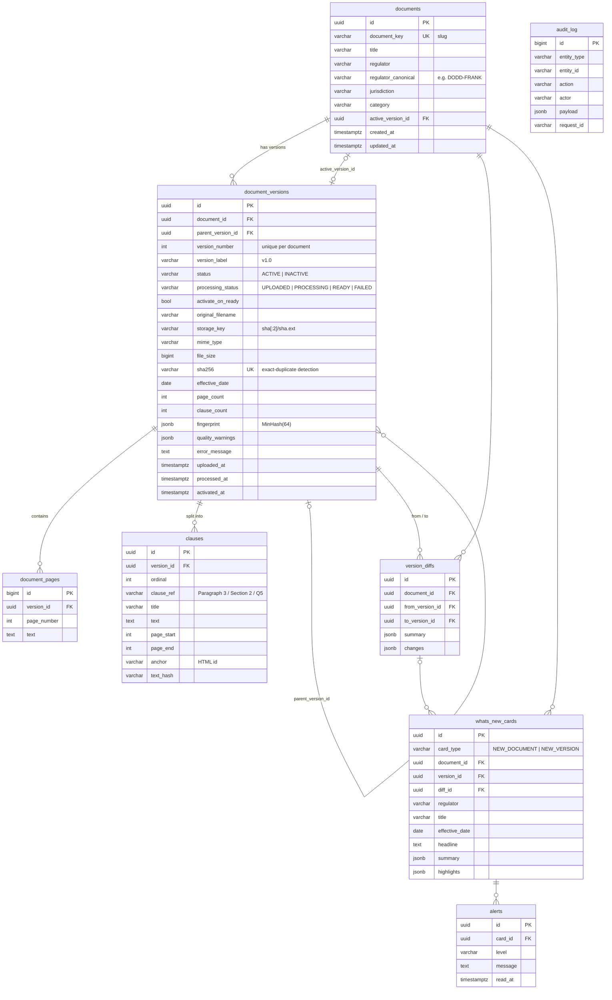
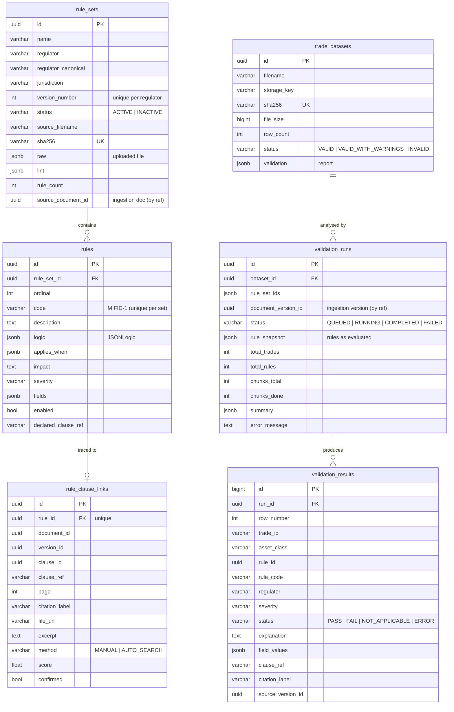

# Data model

Database-per-service on one PostgreSQL 16 instance (separate instances in production). No foreign keys cross
service boundaries — cross-service references (e.g. `validation_runs.document_version_id`) are plain UUIDs resolved
over REST. Every schema change is an Alembic migration in the owning service (`services/<svc>/migrations`).

Conventions: UUID primary keys (except append-only high-volume tables → `BIGINT` identity), `timestamptz` everywhere,
JSONB for flexible payloads, status columns as `VARCHAR` + `CHECK` constraint (cheaper to evolve than PG enums).

## 1. `iris_ingestion` (ingestion-service)

Key constraints
* `uq_document_versions_one_active` — **partial unique index** `(document_id) WHERE status = 'ACTIVE'`: at most one
  ACTIVE version per document, guaranteed by the database even under concurrent activations.
* `document_versions.sha256` unique — exact duplicates are rejected atomically.
* `uq_document_versions_number (document_id, version_number)`, `uq_clauses_ref (version_id, clause_ref)`,
  `uq_version_diffs_pair (from_version_id, to_version_id)`.
* `documents.active_version_id ↔ document_versions.id` is circular; the FK is added after both tables exist
  (`use_alter`) and is `ON DELETE SET NULL`.

## 2. `iris_search` (search-service)

| Table | Purpose |
|---|---|
| `indexed_versions` (`version_id` PK, `document_id`, `status`, `clause_count`, `keyword_indexed`, `semantic_indexed`, `last_error`, `indexed_at`) | Index bookkeeping — which versions are in ES/Chroma, for re-index and health |
| `search_query_log` (`id` bigint, `query`, `mode`, `filters` jsonb, `result_count`, `took_ms`, `created_at`) | Search analytics, zero-result queries |
| `comparisons` (`id`, `left_version_id`, `right_version_id`, labels, `summary`, `changes` jsonb) | Saved comparisons (shareable by id) |

### Elasticsearch index `iris-clauses` (alias → `iris-clauses-v1`)
One document per clause; `_id` = clause id. Mapping: `services/search-service/app/backends/es_mapping.json`
(`dynamic: strict`).

| Field | Type | Use |
|---|---|---|
| `text`, `clause_title`, `document_title` | `text` (custom `reg_text` analyzer: lowercase, ascii-folding, English stop + stemmer) | full-text match + highlight |
| `clause_ref` | `keyword` + `.text` | exact and fuzzy clause lookup ("Paragraph 3") |
| `regulator`, `regulator_canonical`, `jurisdiction`, `category`, `status`, `version_label`, `file_name`, `mime_type` | `keyword` | filters & facets |
| `effective_date` | `date` | range filter |
| `document_id`, `version_id`, `clause_id` | `keyword` | joins back to ingestion, status flips |
| `page_start`, `page_end`, `ordinal`, `anchor` | numeric / non-indexed keyword | citations |

### ChromaDB collection `iris-clauses` (optional)
id = clause id, embedding = MiniLM(`title. text`), metadata = the same filter fields as ES (cosine space).

## 3. `iris_rules` (rules-engine-service)

Key constraints & indexes
* `uq_rule_sets_one_active` — partial unique `(regulator_canonical) WHERE status='ACTIVE'`.
* `validation_results`: `ix_results_run_status`, `ix_results_run_trade`, `ix_results_run_rule` serve the matrix
  filters, pivot and export; `CHECK status IN (…)`.
* Lineage chain for any FAIL: `validation_results → rule_code / rule_id → rule_clause_links (clause, page, version)`
  plus `validation_runs.rule_snapshot` (exact logic used) and `document_version_id`.

## 4. File storage
| Volume | Owner | Layout |
|---|---|---|
| `regulations` → `/data/regulations` | ingestion | content-addressed `ab/abcdef….pdf` |
| `rulesdata` → `/data/rules-engine` | rules | content-addressed `ab/abcdef….csv` |

`FileStorage` is a protocol — swap `LocalFileStorage` for S3/MinIO without touching business code.
