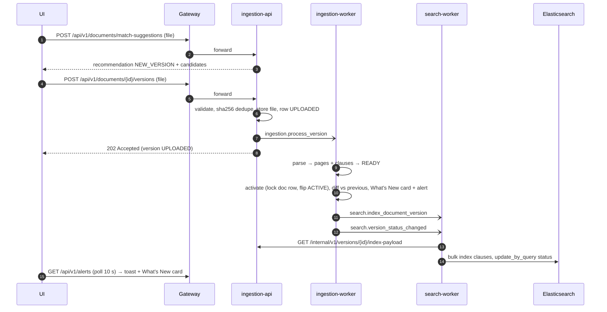
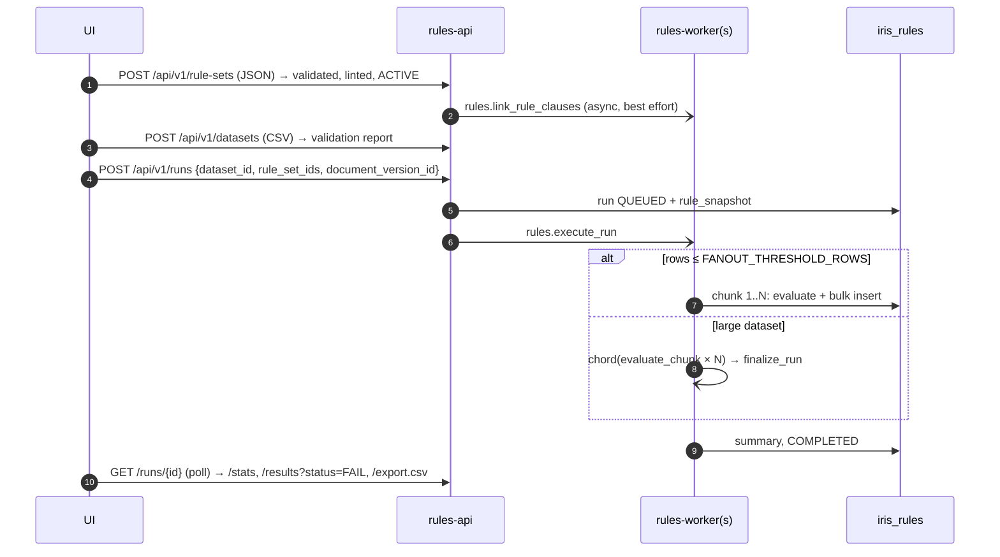

# Service communication

Two channels, both explicit contracts:

| Channel | Used for | Contract lives in |
|---|---|---|
| **REST (sync)** | UI → services (via gateway); service → service reads | Each service's OpenAPI (`/openapi.json`) + `docs/API.md` |
| **Celery tasks sent by name (async)** over Redis | "something happened, do the heavy work" | `libs/iris-common/src/iris_common/events.py` (`Tasks`, `Queues`, payload models) |

Services **never import each other's code**. A producer calls `celery_app.send_task("search.index_document_version",
kwargs=…)`; only the consumer has the implementation. Each worker listens only to its own queue
(`ingestion`, `search`, `rules`) — routing via `TASK_ROUTES`.

## 1. Task catalogue

| Task | Queue | Producer → Consumer | Payload | Semantics |
|---|---|---|---|---|
| `ingestion.process_version` | ingestion | ingestion-api → ingestion-worker | `version_id` | Parse, clauses, fingerprint, activate, diff, What's New, alert. No-op if READY. |
| `search.index_document_version` | search | ingestion-worker → search-worker | `version_id, document_id, status` | Pull `/internal/v1/versions/{id}/index-payload`, bulk index (idempotent). Retries with back-off ×5. |
| `search.version_status_changed` | search | ingestion → search-worker | `document_id, active_version_id \| null` | Flip ACTIVE/INACTIVE for every clause of the document. |
| `rules.execute_run` | rules | rules-api → rules-worker | `run_id` | Inline chunks, or chord fan-out above `FANOUT_THRESHOLD_ROWS`. |
| `rules.evaluate_chunk` | rules | rules-worker → rules-worker (chord) | `run_id, chunk_index` | Delete-then-insert chunk results (retry-safe). |
| `rules.finalize_run` | rules | chord callback | `run_id` | Aggregate summary, mark COMPLETED. |
| `rules.link_rule_clauses` | rules | rules-api → rules-worker | `rule_set_id` | Auto-suggest a clause per rule via search-service. |

Events are emitted **after** the DB transaction commits (consumers never read uncommitted state). Delivery is
at-least-once (`acks_late`), so every consumer is idempotent.

## 2. Synchronous service-to-service calls

| Caller | Endpoint | Why |
|---|---|---|
| search-service | `GET ingestion /internal/v1/versions/{id}/index-payload` | Clauses + metadata to index; also used by `/compare` |
| rules-engine-service | `GET search /api/v1/search?q=…&regulator=…&size=1` | Rule → clause auto-linking (best effort) |

All use `iris_common.http.ServiceClient`: timeouts, 3 retries with exponential back-off on transport/5xx errors,
`X-Request-ID` propagation, optional bearer token. `/internal/*` is **not** routed by the gateway.

## 3. Key flows

### Upload a new version → What's New → searchable

### Impact analysis run

## 4. Contract change rules
1. Additive changes (new optional field, new endpoint, new task) — allowed any time.
2. Breaking changes — add a new version (`/api/v2/...` or a new task name such as `search.index_document_version.v2`),
   run both until consumers migrate, then remove.
3. Every PR touching `events.py`, an `/internal` endpoint or `docs/API.md` needs a reviewer from each consuming team
   (enforced by `CODEOWNERS`).

## 5. Why not Kafka / a service mesh?
The brief mandates Redis + Celery, and the workload is task-oriented (do X for version Y) rather than an event log
that many consumers replay. If more consumers need the same fact later (audit, analytics), publish domain events to a
log (Redis Streams or Kafka) alongside the task — the payload models in `events.py` are already the schema.
